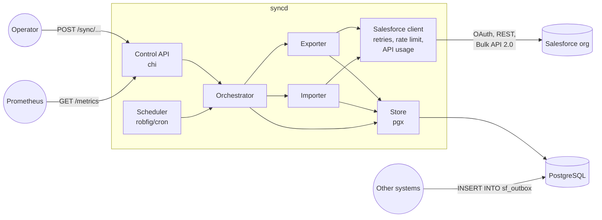
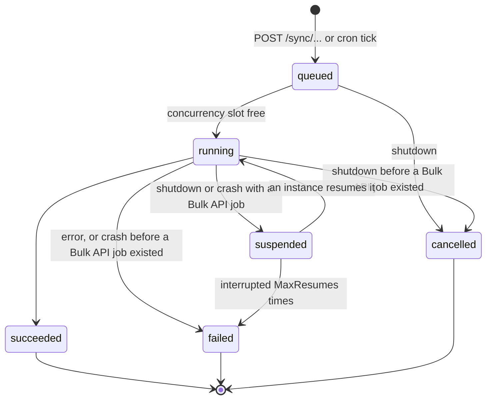
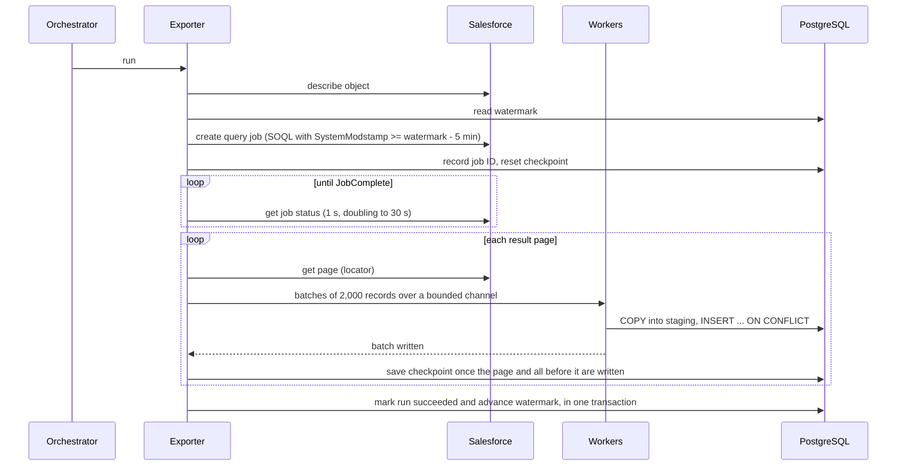
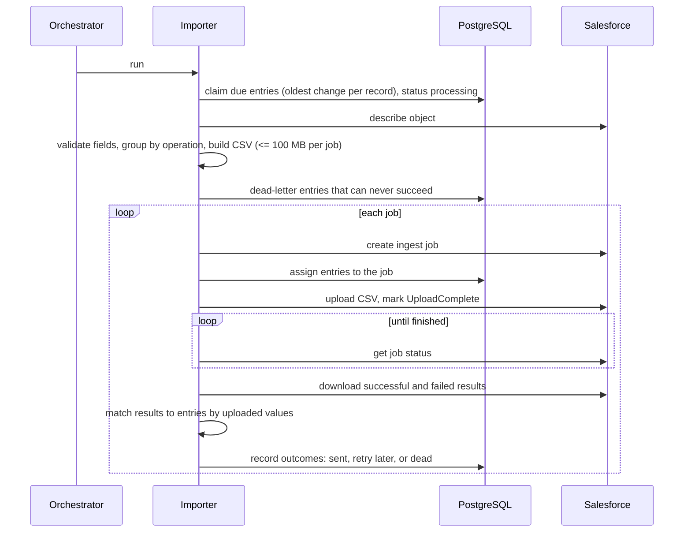
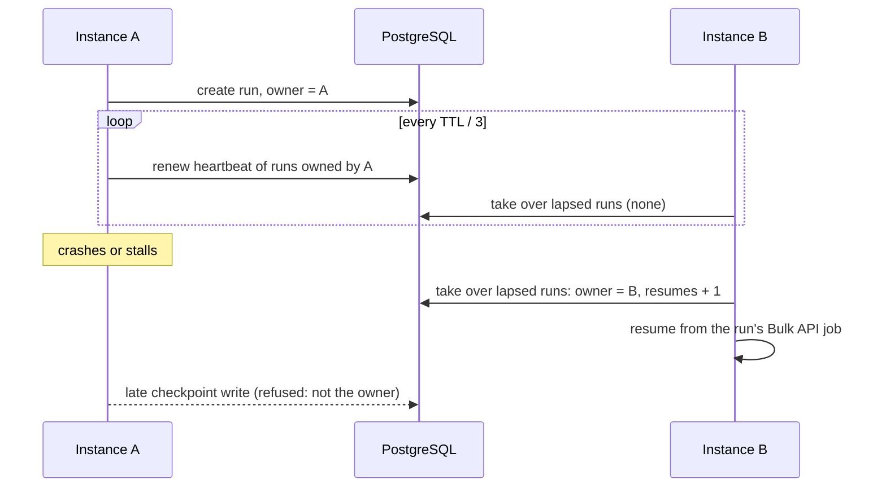

# Architecture

This document explains how data-sync-service is put together and why. The
[README](../README.md) covers setup and day-to-day use.

- [Components](#components)
- [Run lifecycle](#run-lifecycle)
- [Export](#export)
- [Import](#import)
- [Resilience](#resilience)
- [Design decisions](#design-decisions)

## Components

| Package | Responsibility |
|---------|----------------|
| `cmd/syncd` | Wiring, signal handling, graceful shutdown |
| `internal/api` | HTTP control API, health checks, request logging and metrics |
| `internal/config` | Environment configuration and its validation |
| `internal/salesforce` | OAuth client credentials, REST client with retries and rate limiting, API usage tracking, describe, Bulk API 2.0 query and ingest jobs |
| `internal/salesforce/sftest` | An in-process fake org that every test runs against |
| `internal/store` | Migrations, runs, checkpoints, watermarks, record upserts, the outbox |
| `internal/syncer` | Run orchestration and scheduling, the export and import pipelines |
| `internal/retry` | Backoff with full jitter, `Retry-After` parsing |

Dependencies point one way: `api` → `syncer` → `salesforce`, `store`. The
pipelines know nothing about HTTP, and the clients nothing about runs.

## Run lifecycle

Every export or import is a run, recorded in `sync_runs` before any work
starts, so it can always be inspected with `GET /runs/{id}`.

`suspended` is not a stored status: a suspended run stays `running` in the
database, without a lease, until an instance resumes it; see
[Leases](#leases). A unique partial index allows one active run
per object and direction, so a second request gets `409 Conflict` and a
scheduled tick is skipped. A buffered channel of `MAX_CONCURRENT_JOBS` slots
caps how many runs execute at once.

Runs execute under the orchestrator's own context, not the request's, and
shutdown cancels that context. What a cancelled run does depends on how far it
got; see [Resuming runs](#resuming-runs).

## Export

- **Fields** come from the describe result, minus types Bulk API queries cannot
  return (compound address and location fields, `base64`) and deprecated fields.
- **Memory stays flat.** Pages are parsed straight off the network, and the
  channel to the workers holds at most `WORKER_COUNT` batches, so a slow
  database slows the download instead of filling memory.
- **Upserts are idempotent and ordered by time.** A stored record is replaced
  only by a version with an equal or newer `SystemModstamp`, so re-reading a page
  or a late batch can never roll a record back.
- **The watermark moves only on success**, in the transaction that marks the run
  succeeded, and only forward. A failed run leaves it alone, so the next run
  reads the same changes again.
- **Checkpoints.** Batches never span pages. A page counts as committed once all
  of its batches and every earlier page are written; the run then stores the
  next page's locator, the watermark so far, and the record count. A resumed
  run continues from there.

## Import

- **Order per record.** Only the oldest unsent change of each record (by `Id` or
  upsert key) can be claimed, because a Bulk API job processes its rows in no
  particular order.
- **Validation first.** One malformed row would fail the whole job for every
  entry in it, so fields are checked against the describe result before upload.
- **Matching by value.** Results come back unordered and without a caller tag,
  but repeat every uploaded column; each result is matched to the entry that
  produced the same values.
- **Outcomes.** Accepted entries become `sent`. Rejected ones are retried with
  exponential backoff from one minute to an hour, and dead-lettered after
  `IMPORT_MAX_ATTEMPTS`. An entry with no result at all is dead-lettered, not
  retried: Salesforce may have applied it, and repeating an insert would create
  a duplicate.
- **Assignment before upload.** Entries are tied to their ingest job before
  the data is sent, so after a restart the run knows where each entry went.

## Resilience

### Salesforce requests

Every data API call goes through one client:

- **Rate limit.** A token bucket (`golang.org/x/time/rate`) allows
  `API_RATE_LIMIT` requests per second, with bursts of up to one second's worth.
  Retries and job polling count too.
- **Retries.** `429` and `503` are retried for every method, because Salesforce
  did not act on the request; other `5xx` and network errors only for idempotent
  methods. Delays use exponential backoff with full jitter and honour
  `Retry-After`. `REQUEST_LIMIT_EXCEEDED` is never retried: the daily quota is
  spent.
- **Authentication.** Tokens are cached and refreshed a minute before they are
  assumed to expire; one `401` triggers a fresh token without using a retry.

### Org API usage

Salesforce reports the org's rolling 24-hour API usage in the
`Sforce-Limit-Info` header of every response. The client records the latest
figures and exports them as `salesforce_api_usage_requests` and
`salesforce_api_usage_limit`.

The allocation is shared by every integration of the org, so the service stops
starting runs once usage passes `API_USAGE_THRESHOLD` (80% by default): manual
requests get `503` with `Retry-After`, and scheduled ticks are skipped. Runs
already in progress finish, since stopping them half-way would waste the calls
already made. Usage only falls as old requests leave the 24-hour window, so a
report older than five minutes is refreshed from `GET /limits` before a run is
refused.

### Resuming runs

Bulk API jobs keep running in Salesforce whatever happens to the service, so the
service does not abort them on shutdown. A run that already has a job is
suspended instead, giving up its lease, and resumed by the next instance to
start or by a peer:

| Interrupted | Shutdown | Next start |
|-------------|----------|------------|
| Queued, or running without a job | Cancelled; outbox entries return to pending | Failed once its lease lapses, if a crash left it active |
| Export with a query job | Left running, job untouched | Continues from the checkpoint; if Salesforce has deleted the job, starts over with a new one |
| Import with ingest jobs | Left running, jobs untouched | Per job: still open (never closed) → aborted and its entries sent again; in progress or finished → waits and collects the outcomes; deleted → entries dead-lettered, as their outcome is unknown. Entries never uploaded are sent |

For a run with a job, a crash is handled exactly like a shutdown, because
suspending a run writes nothing: everything a resumed run needs (job IDs,
checkpoint, entry assignments) is stored before the work it describes. A run is
resumed at most three times (`store.MaxResumes`); a run that keeps being
interrupted may be what brings the service down, so it is failed instead.

Long exports do not re-download pages they have already stored, and imports
do not upload an entry twice. Outbox entries keep their ingest job until their
outcome is known, so the same holds when a run *fails* after closing a job, for
example because Salesforce stays unreachable for longer than the retries last:
the entries return to pending with their job, and the next run collects the
outcome from it. Entries of a job Salesforce never processed — left open, or
aborted with no records processed — are uploaded again.

### Leases

Several instances can share one database. Every active run is leased by one
instance (`sync_runs.owner`), which renews `heartbeat_at` every third of the
lease TTL (one minute). Each instance also looks for lapsed runs on the same
schedule: unowned ones, such as runs suspended by a shutdown, and ones whose
owner has not renewed within the TTL, presumably because it crashed. Takeover
is a single `UPDATE ... WHERE <lapsed> RETURNING`, so row locks hand each run
to exactly one instance.

Leases are fenced: every write of a run's state, checkpoints and outbox
outcomes included, requires the writer to still own the run. An instance that
stalled past its TTL and lost the run gets errors instead of overwriting the
progress of the instance that took it over, and stops the run as soon as its
next renewal shows the lease gone. Record upserts are not fenced; a stale
batch cannot roll a record back, as the newer-`SystemModstamp`-wins rule
applies.

## Design decisions

**One generic JSONB table for records.** `sf_records` stores every object as
JSONB keyed by field API name. New objects and fields need no migration, and
`data->>'Field'` is enough for most queries. The cost is weaker typing; numeric
fields keep their exact digits as JSON numbers, and views or generated columns
can add typed access where it matters.

**Outbox, not an API, for writes.** Producers insert into `sf_outbox` in their
own transaction, so a change is recorded exactly when their data is, and the
service needs no write endpoint or queue.

**At-least-once into Postgres, exactly-once where Salesforce allows.** Exports
may write a record more than once, which upserts make harmless. Imports send
updates, upserts, and deletes at least once, which is safe to repeat. Inserts
are never uploaded twice, at the cost of dead-lettering them when their
outcome cannot be known: when results cannot be matched, or when Salesforce
has deleted the job before the service could read them.

**Leases rather than a coordinator.** Instances agree through the database
they already share: a unique index allows one active run per object, and
fenced leases say who executes it. There is no leader, no extra service, and
cron runs on every instance; a duplicate start is refused by the index.

**A fake org instead of mocks.** `sftest` implements the token endpoint,
describe, and the Bulk API job lifecycles over real HTTPS, so tests exercise
the real client, retries, pagination, and CSV handling. Failure-injection tests
stop the service mid-run against it and check that a new instance finishes the
run without losing or repeating work.
